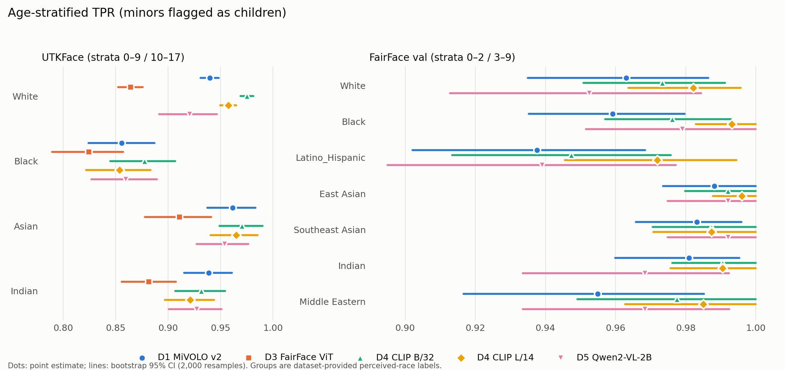

# Do child detectors miss darker-skinned children?

An audit of the automated child detectors used to filter children out of text-to-image training data, measuring whether they fail more often for some demographic groups.

Crețu et al. ([IEEE S&P 2026, arXiv:2512.05707](https://arxiv.org/abs/2512.05707)) showed that the best child detectors still miss more than 6% of child images. They also note that unequal filtering rates across sub-groups would bias what remains in the data. This project measures one such inequality directly: whether detectors miss Black children more often than White children, and why.

**Status:** Phase 1 (controlled pilot on face datasets) complete. Phase 2 (in-the-wild images, Monk skin-tone annotation) not started.

## Phase 1 result

On **UTKFace**, all five detectors flag Black minors as children less often than White minors, after adjusting for age. The gap is 4 to 10 percentage points and significant for every detector after Holm correction. On **FairFace**, no detector shows a detectable gap.

| Detector | UTKFace gap, White − Black [95% CI] | FairFace gap [95% CI] |
|---|---|---|
| D1 MiVOLO v2 (face age) | **0.084** [0.053, 0.119] | 0.004 [−0.031, 0.035] |
| D3 FairFace age classifier | **0.040** [0.004, 0.078] | not run (trained on FairFace) |
| D4 CLIP ViT-B/32 zero-shot | **0.098** [0.067, 0.132] | −0.003 [−0.031, 0.024] |
| D4 CLIP ViT-L/14 zero-shot | **0.104** [0.072, 0.138] | −0.011 [−0.031, 0.007] |
| D5 Qwen2-VL-2B yes/no | **0.061** [0.020, 0.103] | −0.027 [−0.071, 0.017] |

Gap = age-stratified true-positive rate (minors flagged as children) for White minors minus that for Black minors. Source: [`results/phase1/primary_endpoint.json`](results/phase1/primary_endpoint.json).

- **The gap is concentrated in teenagers.** For UTKFace minors aged 10–17, MiVOLO flags 81% of White minors but 56% of Black minors. FairFace's testable minors are all aged 0–9, which likely explains the null result there; this reading was not preregistered.
- **Mechanism: age over-estimation, not missed faces.** MiVOLO over-estimates Black minors' age by about 1.5 years more than White minors' (UTKFace). Face-detection failure is not higher for Black minors.
- **Per-group thresholds can close the gap, but at a high cost.** Equalising detection raises the false-positive rate on Black adults to as much as 0.56, up from 0.04 (CLIP B/32).

Full write-up with caveats: [`docs/PHASE1_REPORT.md`](docs/PHASE1_REPORT.md).



**Caveats.** These are cropped, aligned face photos, which are much easier than real training-data images. Groups are the datasets' perceived-race labels, not measured skin tone. UTKFace has only 280 Black minors, 126 of them aged 10–17. Phase 2 addresses all three.

## Method in brief

- **Preregistered.** Hypotheses, endpoints, strata, tests and detector rules were frozen in [`PREREGISTRATION.md`](PREREGISTRATION.md) (commit `2e92b8b`) before any detector ran on the full data. Every later change is logged there under *Deviations*, including one post-hoc change.
- **Primary endpoint.** White − Black TPR gap, age-stratified with fixed reference weights so groups with older children aren't penalised. 95% CIs from 2,000 within-group bootstrap resamples, a stratified permutation test, and Holm correction across detectors within each dataset.
- **Secondary.** Face-detection failure (H2a), signed age error (H2b), adult false-positive rate (H3), a confounder logistic regression (age, brightness, blur, face size), and per-group threshold equalisation (H5).
- **Provenance.** Every JSON in `results/` stores the config and git commit that produced it. Dataset archives and model weights are pinned by revision and SHA-256 and verified before use.

The full design is in [`EXPERIMENT_PLAN.md`](EXPERIMENT_PLAN.md), and the data sources are described in [`docs/DATA_CARD.md`](docs/DATA_CARD.md).

## Detectors

Each detector outputs `is_child` and a score, where `score > 0` means child. An image with no detected face counts as "not child", as it would in a real filter.

| ID | Model (pinned) | Rule |
|---|---|---|
| D1 | YOLOv8x person/face → [MiVOLO v2](https://huggingface.co/iitolstykh/mivolo_v2) @e8bdd8ae, face only | youngest face's estimated age < 18 |
| D3 | dlib face chips → [FairFace age ViT](https://huggingface.co/dima806/fairface_age_image_detection) @4e02ab80 | expected age over 9 bins < 18 |
| D4 | OpenCLIP ViT-B/32 and ViT-L/14, OpenAI weights | max sim(child prompts) > max sim(adult prompts) |
| D5 | [Qwen2-VL-2B-Instruct](https://huggingface.co/Qwen/Qwen2-VL-2B-Instruct) @895c3a49 | P("yes") > P("no") for "Is there a child (a person under 18 years old) in this image?" |

D1 and D3 correspond to two of the face-based estimators Crețu et al. benchmark (MiVOLO Face, FairFace), but with different checkpoints, and for D3 a different decision rule. D3 uses a FairFace-trained ViT because the original ResNet-34 weights are no longer available, and it is never run on FairFace. D5 runs on a stratified subsample of about 1,900 images per dataset.

## Repository layout

```
configs/config.py        single source of truth: paths (local / Colab), seeds, strata, prompts, pinned data sources
src/
  data/                  loaders → unified Record (group, age, role: minor / adult_fpr / ambiguous, stratum)
  detectors/             one class per detector, common interface in base.py; registry + allowed
                         detector×dataset pairs in __init__.py
  analysis/
    metrics.py           stratified rates, bootstrap and Wilson CIs, permutation test, Holm
    regression.py        confounder logistic regression
    thresholds.py        per-group TPR-equalising thresholds and their FPR cost
    image_stats.py       per-image brightness / contrast / blur
  provenance.py          stamps every results JSON with config + git commit
scripts/
  run_phase0_counts.py   group × age-stratum counts and power check → results/phase0_counts.json
  run_detector.py        one detector on one dataset → per-image CSV (never committed) + run JSON
  make_vlm_subsample.py  seeded stratified subsample for D5
  run_analysis.py        all metrics + primary endpoint → results/phase1/*.json
  make_figures.py        figures/phase1_*.png (charts only)
  unpack_data.py, make_dev_subset.py, write_env.py, smoke_summary.py   setup helpers
notebooks/               Colab drivers, run in order: phase0 → phase11 (smoke) → phase12 (D1/D3/D4)
                         → phase13 (D5) → phase14 (analysis + figures)
tests/                   synthetic recovery test (planted gaps are found, null gives no gap); interval unit tests
results/                 aggregate JSON only: counts, run metadata, metrics, primary endpoint
docs/                    DATA_CARD.md, PHASE1_REPORT.md
```

**Data flow:** loader → `Record`s → detector `predict()` → per-image CSV on Google Drive → `run_analysis.py` → aggregate JSON in `results/` → `make_figures.py`. Per-image outputs and images stay on Drive and are never committed.

## Reproducing

Full runs need a Colab T4 GPU and Google Drive. The datasets (~170 MB) and model weights (several GB) live on Drive, not on the local machine.

1. Run `notebooks/phase0_data_prep.ipynb`. It downloads the pinned UTKFace and FairFace archives to Drive and verifies their SHA-256.
2. Run `phase12_full_runs.ipynb` (D1, D3, D4) and `phase13_vlm.ipynb` (D5). Each clones this repo from GitHub, and phase12 skips runs already saved on Drive.
3. Run `phase14_analysis.ipynb`. It writes `results/phase1/` and `figures/` into a zip on Drive.

To run the analysis tests locally (no data needed, Python 3.11 with [uv](https://docs.astral.sh/uv/)):

```bash
uv sync
.venv/bin/python tests/test_wilson.py
.venv/bin/python tests/test_analysis_synthetic.py
```

## Ethics

- No images of children are generated, and no sexual content or nudity classifiers are used.
- Only established public research face datasets are used, under their licences: UTKFace for non-commercial research, FairFace under CC BY 4.0. Nothing is scraped from the web.
- No images, per-image outputs or per-image labels are committed. Figures contain charts only.
- Group labels are the datasets' own perceived-race annotations. They are used as given and never inferred by a model.

## Citation

If you build on this, please cite the paper it extends:

> A.-M. Crețu, K. Kireev, A. Abdalla, W. Obinna, R. Meier, S. A. Bargal, E. M. Redmiles, C. Troncoso. *Evaluating Concept Filtering Defenses against Child Sexual Abuse Material Generation by Text-to-Image Models.* IEEE S&P 2026. arXiv:2512.05707.

Author: Isaac Mutuma.
